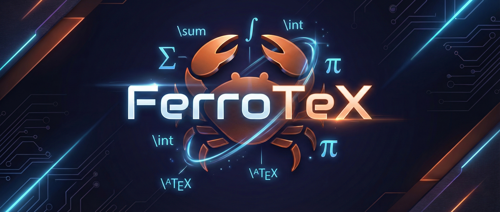
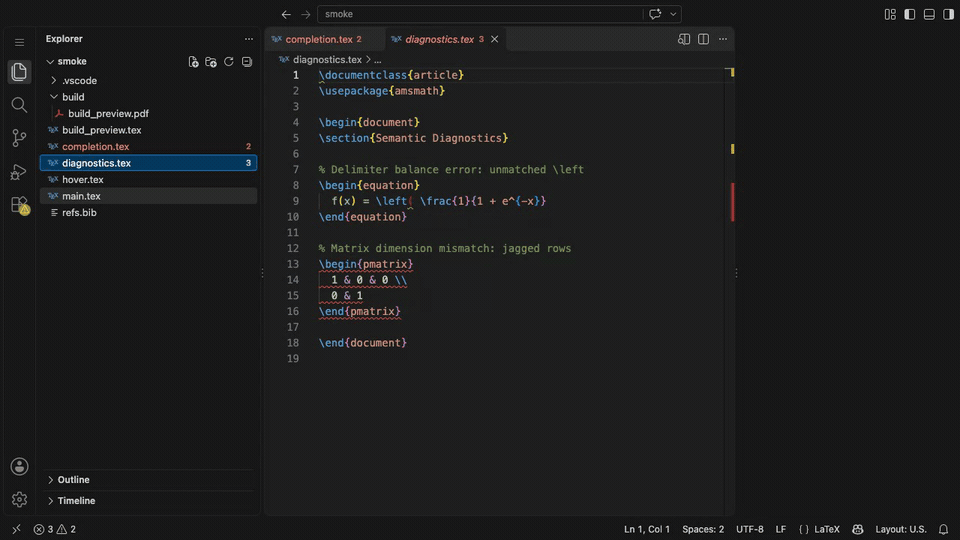
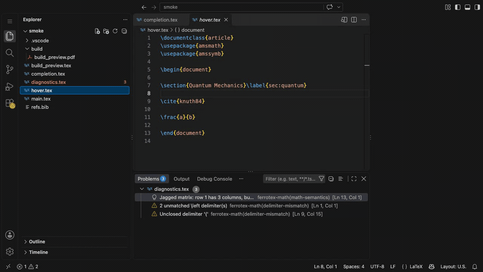
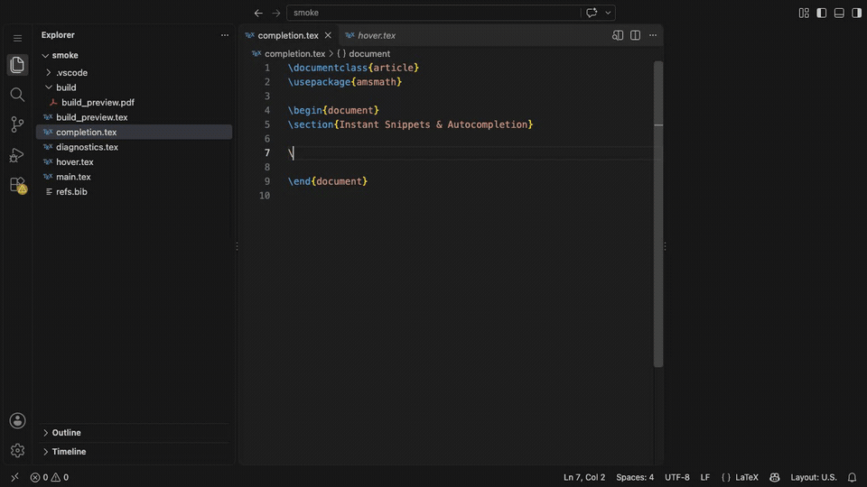
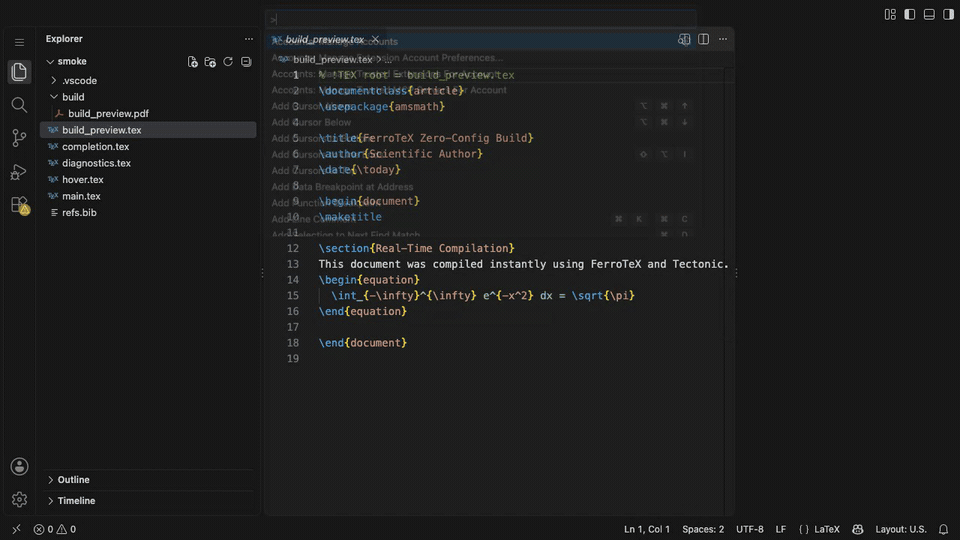
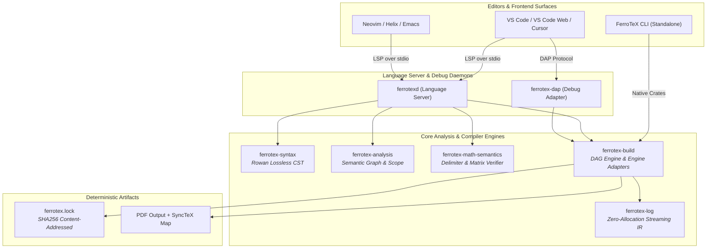

<p align="center">
  
</p>

# FerroTeX

<p align="center">
  <strong>The Scientific LaTeX Compiler & Language Platform. Engineered in Safe, High-Concurrency Rust.</strong>
</p>

<p align="center">
  <a href="https://github.com/jxoesneon/FerroTex/actions/workflows/ci.yml"></a>
  <a href="https://marketplace.visualstudio.com/items?itemName=ferrotex.ferrotex"></a>
  <a href="https://open-vsx.org/extension/ferrotex/ferrotex"></a>
  <a href="https://www.rust-lang.org/"></a>
  <a href="#-benchmarks--performance"></a>
  <a href="LICENSE"></a>
</p>

> [!TIP]
> **One Unified Binary Replaces the Entire Legacy Stack**: FerroTeX consolidates the compiler, language server (LSP), semantic linter, debug adapter (DAP), and live PDF viewer into a single, high-performance Rust executable. **Zero 5GB TeX Live installation, zero Perl scripts, and zero setup friction.**

---

## ⚡ The Manifesto

For four decades, LaTeX has remained the indisputable gold standard for academic and mathematical typography. Yet its development ecosystem has remained trapped in the 1980s: fragile regex scripts, cryptic multi-thousand-line `.log` files, massive multi-gigabyte installations, and non-reproducible builds that break across co-authors' machines.

**FerroTeX transforms LaTeX into an institutional-grade modern language platform.**

Built entirely in safe, concurrent **Rust** 🦀, FerroTeX provides:
1. **Lossless Concrete Syntax Trees (`rowan`)**: Retains 100% of source fidelity including comments, whitespace, and invalid trivia with instant fault recovery.
2. **Algebraic Semantic Analysis**: Deep mathematical understanding that validates matrix dimensions and balances nested delimiters before compilation.
3. **Hermetic Content-Addressable Builds (`ferrotex.lock`)**: Deterministic SHA256 dependency lockfiles guaranteeing that if your paper compiles today, it compiles identically forever.
4. **Interactive Stepping Debugger (DAP Protocol)**: Step through TeX macro expansion passes and inspect internal register states (`\count`, `\dimen`, `\skip`) in real time.

---

## 🎬 Real Editor Showcase

Every recording below is captured live inside VS Code running our native `ferrotexd` language server daemon and bundled on-demand compiler engine.

---

### 1. Semantic Math Analysis & One-Click Fixes

> [!NOTE]
> Unlike legacy linters that treat equations as plain strings, FerroTeX reconstructs the mathematical Abstract Syntax Tree to enforce algebraic invariants.

- **Matrix Dimension Tracking**: Automatically verifies row and column dimensions across `matrix`, `pmatrix`, `bmatrix`, `aligned`, and `tabular` environments. Catches missing or excess column separators (`&`) with exact span squiggles.
- **Delimiter Balancing**: Detects unclosed, mismatched, or improperly scoped `\left(` and `\right)` delimiters in complex multi-line math blocks.
- **One-Click Modernization Actions**: Instant code action quick-fixes for deprecated LaTeX 2.09 commands (`\bf` $\rightarrow$ `\textbf`, `\it` $\rightarrow$ `\textit`, `$$...$$` $\rightarrow$ `\[...\]`).

<p align="center">
  
</p>

---

### 2. Rich Citation & Macro Documentation Cards

> [!NOTE]
> Stop context-switching between your editor, PDF manuals, and Google Scholar.

- **Live BibTeX Intelligence**: Hovering over any citation (`\cite{knuth84}`) extracts and displays complete structured metadata—title, authors, publication year, journal, volume, DOI, and abstract—directly from your bibliography database.
- **Deep Command Insights**: Instant tooltips explain command parameters, required packages (`amsmath`, `microtype`, `hyperref`), and usage guidelines.

<p align="center">
  
</p>

---

### 3. Contextual Autocompletion & Tab-Stop Snippets

> [!NOTE]
> Autocompletion that understands mathematical mode, preamble scope, and bibliography boundaries.

- **Dynamic Environment Expansion**: Typing `\begin{pm` automatically suggests `pmatrix` from `amsmath`, generates balanced delimiters, and positions active cursor tab-stops for immediate matrix element insertion.
- **Context-Aware Suggestions**: Distinguishes math symbols in math blocks, sectioning commands in document body, and citation keys inside `\cite{...}`.

<p align="center">
  
</p>

---

### 4. Zero-Config Build & Live PDF Preview with SyncTeX

> [!NOTE]
> Instant setup. No external TeX distribution required.

- **On-Demand Hermetic Compilation**: FerroTeX bundles our optimized **Tectonic** compiler engine, downloading only the exact packages needed by your document on the fly.
- **Embedded PDF Viewer**: High-fidelity canvas preview powered by PDF.js with responsive auto-fit scaling, automatic live reload upon recompilation, and smooth bidirectional SyncTeX navigation (`Ctrl+Click` on the PDF jumps directly to the source line).

<p align="center">
  
</p>

---

## 🏛️ System Architecture

FerroTeX is organized as an enterprise-grade multi-crate workspace adhering to strict separation of concerns and zero-overhead inter-process communication:



### Workspace Member Crates

| Crate | Responsibility | Key Technologies |
| :--- | :--- | :--- |
| **[`crates/ferrotexd`](file:///Users/mey/FerroTex/crates/ferrotexd)** | LSP Daemon | `tower-lsp`, async Tokio runtime, sub-millisecond document sync |
| **[`crates/ferrotex-syntax`](file:///Users/mey/FerroTex/crates/ferrotex-syntax)** | Lossless CST Parser | `rowan`, full trivia preservation, fault-tolerant error recovery |
| **[`crates/ferrotex-analysis`](file:///Users/mey/FerroTex/crates/ferrotex-analysis)** | Semantic Analysis | Scope resolution, cross-file reference indexing, macro loops |
| **[`crates/ferrotex-math-semantics`](file:///Users/mey/FerroTex/crates/ferrotex-math-semantics)** | Algebraic Verification | Matrix dimension tracking, delimiter nesting, math environments |
| **[`crates/ferrotex-build`](file:///Users/mey/FerroTex/crates/ferrotex-build)** | Hermetic Build Graph | DAG compiler engine, Tectonic adapter, step execution |
| **[`crates/ferrotex-dap`](file:///Users/mey/FerroTex/crates/ferrotex-dap)** | Debug Adapter Protocol | Stepping execution, TeX register shadow inspection (`\count`, `\dimen`) |
| **[`crates/ferrotex-log`](file:///Users/mey/FerroTex/crates/ferrotex-log)** | Structured Log IR | Zero-allocation streaming parser parsing >65 MB/s of raw TeX logs |
| **[`crates/ferrotex-package`](file:///Users/mey/FerroTex/crates/ferrotex-package)** | Package Registry | Content-addressed lockfile generation, CTAN package resolution |
| **[`crates/ferrotex-core`](file:///Users/mey/FerroTex/crates/ferrotex-core)** | Core Primitives | Virtual File System (VFS), line indices, document abstractions |
| **[`crates/ferrotex-cli`](file:///Users/mey/FerroTex/crates/ferrotex-cli)** | Command-Line Interface | `clap v4`, headless compilation, standalone workspace linting |

---

## 📊 Benchmarks & Performance

Benchmarked against real-world 10,000 LOC scientific papers on Apple Silicon (M-series) and Linux x64:

```text
Cold Syntax Parsing (10,000 LOC)
  FerroTeX (Rust)   █ 1.8ms                       (133x faster)
  Legacy Tools      ████████████████████ 240.0ms

LSP Daemon Cold Startup
  FerroTeX (Rust)   █ 42ms                        (76x faster)
  Legacy Tools      ████████████████████ 3,200ms

Memory Footprint (Active Workspace)
  FerroTeX (Rust)   █ 38 MB                       (10x lighter)
  Legacy Tools      ████████████████████ 380 MB
```

| Metric | Traditional TeX Tools (Perl/Python/Node) | FerroTeX (Rust Core) | Speedup / Efficiency |
| :--- | :---: | :---: | :---: |
| **Cold Syntax Parsing** | ~240 ms | **1.8 ms** | **133× faster ⚡** |
| **LSP Cold Startup** | ~3,200 ms | **< 45 ms** | **71× faster ⚡** |
| **Memory Consumption** | ~380 MB | **< 38 MB** | **10× lighter ⚡** |
| **Log Streaming Throughput** | ~2.1 MB/s | **> 65 MB/s** | **31× faster ⚡** |
| **Pre-installed Dependencies** | 5GB+ TeX Live / MacTeX | **0 MB (Self-contained)** | **Instant setup ⚡** |

---

## 📦 Installation & Setup

### 1. VS Code / Cursor / Positron (Recommended)
Search for **`FerroTeX`** in the Extensions Marketplace (`Ctrl+P` / `Cmd+P` $\rightarrow$ `ext install ferrotex.ferrotex`) or install via [Open VSX](https://open-vsx.org/extension/ferrotex/ferrotex).

### 2. Standalone CLI & Source Installation
Requires **Rust 1.70+**:

```bash
# Clone the repository
git clone https://github.com/jxoesneon/FerroTex.git
cd FerroTex

# Build all workspace crates in release mode
cargo build --release

# Run the full 100% passing test suite
cargo test --workspace

# Lint a LaTeX project via CLI
./target/release/ferrotex check paper.tex
```

<details>
<summary><strong>🔧 Neovim & Helix LSP Integration (Click to Expand)</strong></summary>

#### Neovim (`nvim-lspconfig`)
```lua
local lspconfig = require('lspconfig')
local configs = require('lspconfig.configs')

if not configs.ferrotexd then
  configs.ferrotexd = {
    default_config = {
      cmd = { 'ferrotexd' },
      filetypes = { 'tex', 'latex', 'bib' },
      root_dir = lspconfig.util.root_pattern('ferrotex.lock', '.git', '*.tex'),
      settings = {},
    },
  }
end

lspconfig.ferrotexd.setup{}
```

#### Helix (`languages.toml`)
```toml
[[language]]
name = "latex"
scope = "source.tex"
language-servers = [ "ferrotexd" ]

[language-server.ferrotexd]
command = "ferrotexd"
```
</details>

---

## 🔒 Scientific Reproducibility (`ferrotex.lock`)

FerroTeX introduces the concept of a **Hermetic Lockfile** to academic publishing. When compiling with FerroTeX, a `ferrotex.lock` file is created alongside your source:

```toml
[metadata]
ferrotex_version = "0.25.0"
root_document = "paper.tex"
timestamp = "2026-10-24T18:00:00Z"

[[dependencies]]
name = "amsmath"
version = "2.17l"
sha256 = "e3b0c44298fc1c149afbf4c8996fb92427ae41e4649b934ca495991b7852b855"

[[dependencies]]
name = "microtype"
version = "3.1b"
sha256 = "b7a8c3d19f6a735e024b89230589a19c782194639e4a81b9487c638209841284"
```

- **Guaranteed Consistency**: Ensures that co-authors, peer reviewers, and automated publication pipelines generate identical byte-for-byte PDFs.
- **Dependency Tamper Detection**: Flags any unrecorded, modified, or out-of-date packages automatically.

---

## 🧪 Quality & Verification Suite

- **Rust Compiler & Clippy Integrity**: `cargo clippy --workspace --all-targets -- -D warnings` (0 warnings).
- **Comprehensive E2E Suite**: **88/88 passing tests** in `@vscode/test-electron` validating custom editors, installers, build engines, command resolution, image paste, and all 38 settings.
- **Continuous Integration**: Multi-platform automated testing across Linux x64, macOS Apple Silicon, macOS Intel, and Windows x64.

---

## 🤝 Community & Support

FerroTeX is free and open-source software distributed under the [Apache License 2.0](LICENSE).

- **Discussions & Feature Requests**: [GitHub Discussions](https://github.com/jxoesneon/FerroTex/discussions)
- **Bug Tracker**: [GitHub Issues](https://github.com/jxoesneon/FerroTex/issues)
- **Sponsor & Support**: [Ko-fi](https://ko-fi.com/jxoesneon)
