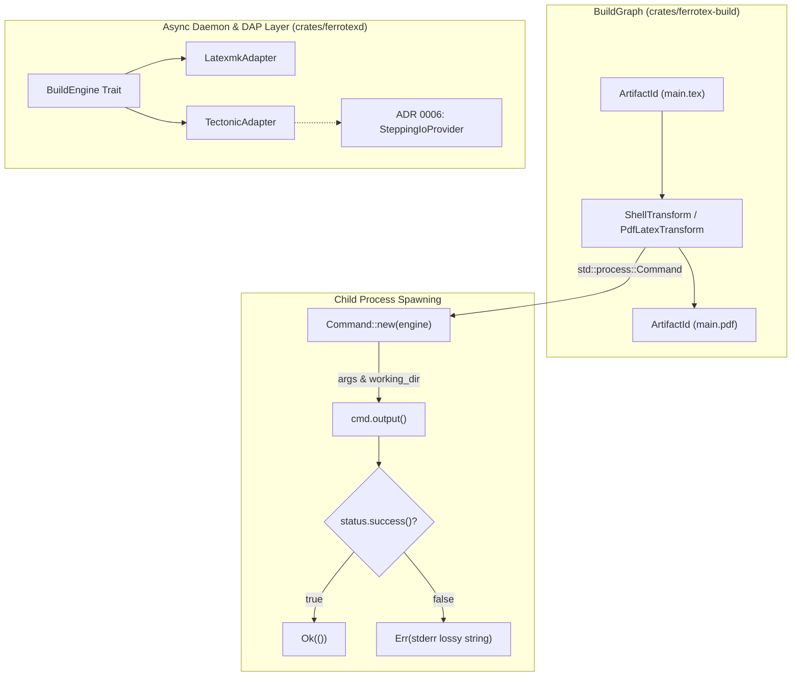

# `crates/ferrotex-build/src/compiler.rs`

> [!info] File Overview
> - **Crate/Domain**: `ferrotex-build` (build)
> - **Layer**: `build`
> - **Language/Type**: `rust` (source-code)
> - **Lines of Code**: 237
> - **Hub**: [[FerroTex Overview]] | [[Crates Index]]

## Purpose & Architecture Role

`crates/ferrotex-build/src/compiler.rs` defines the foundational compilation primitives and shell transformation adapters for the FerroTex build orchestration engine. It bridges abstract [[crates/ferrotex-build/src/lib.rs|BuildGraph]] transforms with physical OS processes by:

1. **Configuring TeX Engines**: Modeling CLI invocations (`Compiler`) for external TeX distributions (such as TeX Live's `pdflatex`, `xelatex`, `lualatex`, or `tectonic`).
2. **Encapsulating Shell Execution**: Providing a generic DAG-compatible execution wrapper (`ShellTransform`) that implements [[crates/ferrotex-build/src/lib.rs|Transform]], linking input and output [[crates/ferrotex-build/src/artifacts.rs|ArtifactId]]s.
3. **Specializing Standard Engine Transforms**: Supplying opinionated transforms like `PdfLatexTransform` with safe default arguments (`-interaction=nonstopmode`, output directory isolation) for non-interactive automated compilations.

Together with the daemon-level runners in [[crates/ferrotexd/src/build/mod.rs|ferrotexd build module]], this module implements the process invocation layer specified in [[docs/spec/engine-adapters.md|Engine Adapters Spec]].

---

## Key Symbols & Interfaces

### Summary Table

| Kind | Identifier | Visibility | Description |
|---|---|---|---|
| `struct` | `Compiler` | `pub` | Configuration builder for TeX engine CLI invocations |
| `struct` | `ShellTransform` | `pub` | Generic command execution transform implementing `Transform` |
| `struct` | `PdfLatexTransform` | `pub` | Specialized `Transform` wrapper running `pdflatex` with standard arguments |
| `impl` | `Compiler::new` | `pub` | Initializes a new `Compiler` with engine name and output path |
| `impl` | `Compiler::with_args` | `pub` | Builder method chaining additional CLI arguments |
| `impl` | `ShellTransform::new` | `pub` | Instantiates a command step with declared inputs, outputs, command, and args |
| `impl` | `ShellTransform::with_working_dir` | `pub` | Sets the child process working directory |
| `impl` | `Transform for ShellTransform` | `pub` | Implements DAG execution, dependency reporting, and child process invocation |
| `impl` | `PdfLatexTransform::new` | `pub` | Constructs a pdflatex transform with standard flags and working directory |
| `impl` | `Transform for PdfLatexTransform` | `pub` | Delegates DAG execution directly to inner `ShellTransform` |

### Detailed Definitions

#### `pub struct Compiler`
Holds parameters for launching an external compilation engine:
- `pub engine: String`: Executable name or path (e.g., `"pdflatex"`, `"xelatex"`, `"tectonic"`).
- `pub output_dir: PathBuf`: Destination directory where compilation outputs are emitted.
- `pub extra_args: Vec<String>`: Custom user/workspace CLI flags appended to invocations.
- Methods:
  - `pub fn new(engine: &str, output_dir: PathBuf) -> Self`
  - `pub fn with_args(mut self, args: Vec<String>) -> Self`

#### `pub struct ShellTransform`
Executes an arbitrary command as a verified build step within the [[crates/ferrotex-build/src/lib.rs|BuildGraph]]:
- `description: String`: Human-readable label for logging and diagnostic attribution.
- `input_ids: HashSet<ArtifactId>`: Prerequisite artifacts required prior to execution.
- `output_ids: HashSet<ArtifactId>`: Artifacts produced upon successful completion.
- `command: String`: Binary to spawn via `std::process::Command`.
- `args: Vec<String>`: Structured argument array avoiding shell injection.
- `working_dir: Option<PathBuf>`: Execution directory context.
- Implements `Transform`:
  - `fn description(&self) -> String`
  - `fn inputs(&self) -> HashSet<ArtifactId>`
  - `fn outputs(&self) -> HashSet<ArtifactId>`
  - `fn execute(&self) -> Result<(), String>`

#### `pub struct PdfLatexTransform`
A dedicated preconfigured transform for LaTeX document generation:
- Wraps an `inner: ShellTransform`.
- Pre-populates flags: `vec!["-interaction=nonstopmode", format!("-output-directory={}", output_dir.display()), tex_path.to_string_lossy().to_string()]`.
- Establishes working directory as parent directory of the `.tex` file or fallback `output_dir`.

---

## Execution Model & Process Mechanics

### 1. Process Spawning & Argument Safety
- In adherence to [[docs/spec/engine-adapters.md|Engine Adapters Spec]] (R1, R2, R3), commands are constructed using structured arrays (`Vec<String>`) passed directly to `std::process::Command::args`, preventing shell interpolation vulnerabilities.
- Working directories are explicitly set via `Command::current_dir` to ensure reproducible file resolution and avoid polluting the workspace root.

### 2. Output Capture & Status Evaluation
- Synchronous builds in `ShellTransform::execute()` invoke `cmd.output()` to capture both standard output and standard error streams.
- Exit statuses are checked via `output.status.success()`. Upon failure, standard error is formatted into a readable UTF-8 lossy string and returned as `Err(String)`.
- For interactive daemon use cases, real-time log tailing and streaming are handled by asynchronous runners in [[crates/ferrotexd/src/build/mod.rs|ferrotexd build module]] and [[crates/ferrotexd/src/build/latexmk.rs|latexmk.rs]].

### 3. Stepping Execution & Interactive Debugging
- While `compiler.rs` implements batch DAG stepping, fine-grained instruction/macro stepping for the Debug Adapter Protocol (DAP) is detailed in [[docs/adrs/0006-tectonic-stepping-io.md|ADR 0006]].
- Under ADR 0006, Tectonic's internal I/O layer is intercepted by `SteppingIoProvider` to halt on macro expansions, file reads, and page ships without requiring external OS process signals (`SIGSTOP`/`SIGCONT`).

---

## Dependencies

- **[[crates/ferrotex-build/src/lib.rs|build lib.rs]]**: Consumes `ArtifactId` and the `Transform` trait contract.
- **[[crates/ferrotex-build/src/artifacts.rs|artifacts.rs]]**: Connects input/output IDs with content-addressed and path-based artifacts (such as `FileArtifact`).
- **`std::process::Command`**: Rust standard library mechanism for synchronous process spawning and output retrieval.
- **`std::collections::HashSet`**: Storage and query interface for DAG artifact dependency sets.
- **`std::path::PathBuf`**: Filesystem path management for input documents and build directories.

---

## Consumers & Dependents

- **[[crates/ferrotex-build/src/lib.rs|build lib.rs]]**: Publicly re-exports `Compiler`, `ShellTransform`, and `PdfLatexTransform` for the crate's external interface.
- **[[crates/ferrotexd/src/build/mod.rs|ferrotexd build module]]**: Serves as the asynchronous runtime counterpart orchestrating background compilation jobs.
- **[[crates/ferrotexd/src/build/latexmk.rs|latexmk adapter]]**: Daemon-level async runner supporting `latexmk` reruns and stream redirection.
- **[[crates/ferrotexd/src/build/tectonic.rs|tectonic adapter]]**: Daemon-level async runner supporting embedded/packaged Tectonic compilation.

---

## Related Specs & ADRs

- **[[docs/spec/engine-adapters.md|Engine Adapters Spec]]**: Normative standard defining deterministic command construction, argument isolation, working directory control, artifact discovery, and process cancellation.
- **[[docs/adrs/0006-tectonic-stepping-io.md|ADR 0006: Tectonic Stepping I/O Provider for DAP]]**: Architectural decision for granular stepping and observable execution in TeX compilation passes.
- **[[docs/adrs/0005-universal-build-dag.md|ADR 0005: Universal Build DAG]]**: Architectural decision specifying the artifact/transform directed acyclic graph implemented across `ferrotex-build`.
- **[[docs/spec/build-orchestration.md|Build Orchestration Spec]]**: Lifecycle specification for pipeline execution, artifact verification, and multi-engine fallback.
