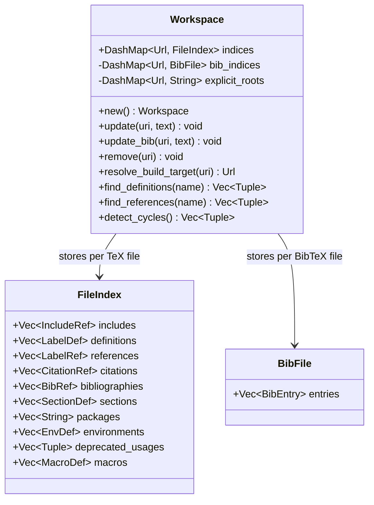
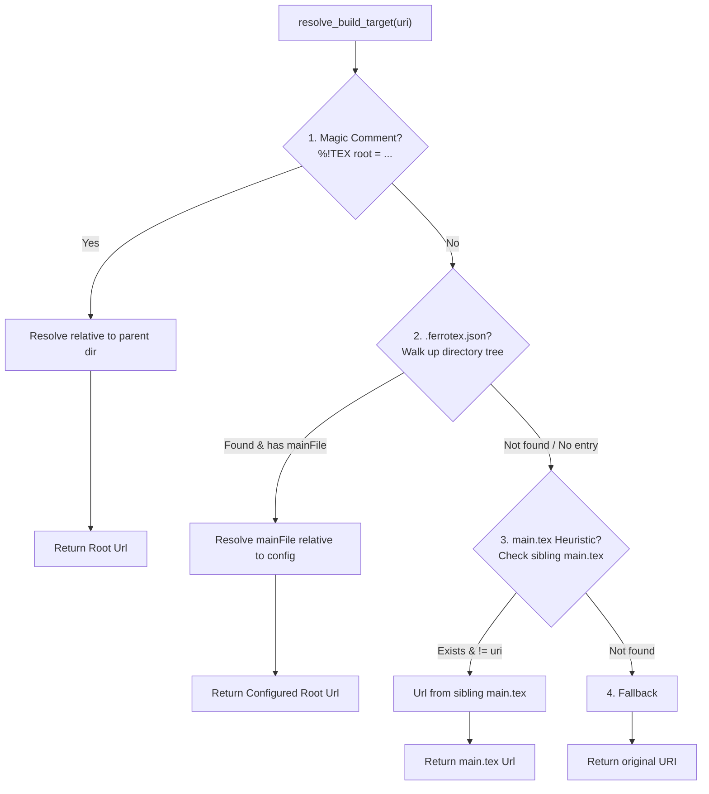

# `crates/ferrotexd/src/workspace.rs`

## Purpose & Architecture Role

`crates/ferrotexd/src/workspace.rs` implements the core **[[docs/spec/project-model.md|Project Model]]** and in-memory index for the FerroTeX Language Server daemon (`ferrotexd`). It acts as a concurrent, thread-safe repository that captures the syntactic and semantic structure of multi-file LaTeX projects.

### Architectural Responsibilities:
1. **In-Memory Document & Index Tracking**: Maintains per-document metadata (includes, labels, citations, bibliographies, section headers, environments, macros, and deprecations) across concurrent LSP worker threads without blocking read access.
2. **Project Root Discovery & Build Target Resolution**: Resolves root compilation targets using a 4-tier heuristic cascade (`%!TEX root` magic comments, `.ferrotex.json` configuration traversal, sibling `main.tex` discovery, and self fallback).
3. **Cross-File Symbol & Reference Resolution**: Powers LSP features like "Go to Definition", "Find References", workspace-wide symbol search (`workspace/symbol`), and hover documentation for citations and labels.
4. **Graph Cycle & Diagnostic Validation**: Traverses the document inclusion graph via Depth-First Search (DFS) to detect recursive inclusion loops, validates citation keys against parsed BibTeX files, and flags duplicate label definitions or deprecated LaTeX2e practices.
5. **Coordination with the VFS & Parser Pipeline**: Ingests CST outputs generated by the [[crates/ferrotex-syntax/src/parser.rs|syntax parser]] and integrates with the in-memory document buffers managed by [[crates/ferrotexd/src/lib.rs|ferrotexd lib.rs]] in conformance with the [[docs/spec/vfs.md|VFS Spec]] and [[docs/spec/incremental-analysis.md|Incremental Analysis Spec]].

---

## State & Data Structures

### Core Structs & Fields

#### `Workspace`
The primary concurrency container for workspace state:
- `pub indices: DashMap<Url, FileIndex>`: Lock-free concurrent hash map storing extracted indexing metadata for all active LaTeX documents.
- `bib_indices: DashMap<Url, ferrotex_syntax::bibtex::BibFile>`: Concurrent index containing parsed AST structures of referenced `.bib` bibliography files.
- `explicit_roots: DashMap<Url, String>`: Map of document URIs to explicit parent entrypoint paths extracted from `% !TEX root` magic comments.

#### `FileIndex`
Captures semantic items identified in a single `.tex` document:
- `pub includes: Vec<IncludeRef>`: Targets of `\input{...}` and `\include{...}` directives.
- `pub definitions: Vec<LabelDef>`: Locations and identifiers of `\label{...}` targets.
- `pub references: Vec<LabelRef>`: Locations and identifiers of `\ref{...}` calls.
- `pub citations: Vec<CitationRef>`: Citation keys referenced via `\cite{...}`.
- `pub bibliographies: Vec<BibRef>`: Referenced bibliography databases (`\bibliography{...}`, `\addbibresource{...}`).
- `pub sections: Vec<SectionDef>`: Document structural headers (`\chapter`, `\section`, `\subsection`, etc.).
- `pub packages: Vec<String>`: Package dependencies imported via `\usepackage` or `\RequirePackage`.
- `pub environments: Vec<EnvDef>`: Scoped environment spans (`\begin{...}` to `\end{...}`).
- `pub deprecated_usages: Vec<(TextRange, String)>`: Occurrences of obsolete font switchers (`\bf`, `\it`, etc.) or raw display math (`$$ ... $$`).
- `pub macros: Vec<MacroDef>`: User-defined macros scanned via `crate::macros::scan_macros`.

#### Auxiliary Reference Structs
All reference records track exact byte offset spans using Rowan-native `TextRange`:
- `IncludeRef`: `{ path: String, range: TextRange }`
- `LabelDef` / `LabelRef`: `{ name: String, range: TextRange }`
- `CitationRef`: `{ key: String, range: TextRange }`
- `BibRef`: `{ path: String, range: TextRange }`
- `SectionDef`: `{ name: String, range: TextRange }`
- `EnvDef`: `{ name: String, range: TextRange }`

---

## Key Algorithms & Subsystems

### 1. In-Memory Document Storage & Coordinate System

`Workspace` interacts closely with the daemon's VFS layer:
- **Buffer Storage**: Active text buffers are maintained in `Backend::documents: Arc<DashMap<Url, String>>` in [[crates/ferrotexd/src/lib.rs|ferrotexd lib.rs]].
- **Range Conversions**: While `Workspace` stores token and node ranges using 0-indexed byte-based `TextRange` (from [[crates/ferrotex-syntax/src/parser.rs|syntax parser]]), conversion to LSP 0-indexed line/column (`Position` / `Range`) is handled dynamically using `line_index::LineIndex`.
- **Thread Safety**: Concurrent read/write queries avoid global mutexes by leveraging `dashmap::DashMap`, allowing background diagnostics, syntax highlighting, and completion handlers to query indices concurrently.

### 2. Project Root Discovery & Build Target Resolution

`Workspace::resolve_build_target(&self, uri: &Url) -> Url` implements entrypoint discovery per the [[docs/spec/project-model.md|Project Model Spec]]:

1. **Magic Comment (`%!TEX root`)**: Checks the first 1KB (`head`) of the file for `% !TEX root = <path>`. Resolves relative to the document's parent directory.
2. **Project Configuration (`.ferrotex.json`)**: Recursively walks up parent directories starting from the document folder until root is reached. Reads `mainFile` field if present.
3. **Standard Heuristic (`main.tex`)**: Inspects the document's immediate directory for a sibling file named `main.tex`.
4. **Fallback**: Returns the current document URI unchanged.

### 3. Auxiliary File Resolution & Package Inheritance

- **Bibliography Resolution (`resolve_bib_uri`)**:
  - Trims quotes and whitespace.
  - Automatically appends `.bib` extension if missing.
  - Resolves target path relative to document base URI (`base_uri.join(&path)`).
- **Inherited Package Context (`get_packages`)**:
  - Gathers packages declared directly in the active file.
  - If the document defines an explicit root, fetches and unions package imports from the parent root document, ensuring completion and linting engines retain full macro awareness.

### 4. Graph Traversal & Cycle Detection (`detect_cycles`)

To prevent infinite loops during cross-file parsing and build generation, `detect_cycles` builds an inclusion snapshot:
- Constructs a directed graph `HashMap<Url, Vec<(Url, TextRange, String)>>` from all indexed `IncludeRef` paths.
- Executes Depth-First Search (DFS) tracking visited nodes and an active call stack (`path_stack: Vec<Url>`).
- Identifies back-edges (`path_stack.contains(target)`) and produces deduplicated diagnostics pointing to the exact range of the offending `\input` or `\include`.

### 5. Document Synchronization & Single-Pass Scanning

When an editor notifies the server of document changes (`didOpen`, `didChange`), `Workspace::update(uri, text)` triggers:
1. **Magic Root Extraction**: Fast regex match on the initial 1024 bytes.
2. **CST Generation**: Generates full concrete syntax tree via `ferrotex_syntax::parse(text)`.
3. **AST Traversal**: Single pass over `root.descendants_with_tokens()` extracting commands, arguments, groups, and math environments.
4. **Macro Scanning**: Delegates to `scan_macros(&root)` for `\newcommand`, `\def`, and `\renewcommand` declarations.
5. **Deprecated Construct Linting**: Identifies TeX 2.09 font tags (`\bf`, `\it`, `\rm`, etc.) and raw display math delimiters (`$$...$$`).

---

## Key Interfaces & Exports

| Symbol | Signature / Type | Description |
|---|---|---|
| `Workspace` | `struct` | Central thread-safe workspace index. |
| `Workspace::new` | `fn() -> Self` | Allocates a default empty workspace. |
| `Workspace::update` | `fn(&self, uri: &Url, text: &str)` | Performs full CST scan of a TeX file and updates index. |
| `Workspace::update_bib` | `fn(&self, uri: &Url, text: &str)` | Parses BibTeX text and populates bibliography index. |
| `Workspace::remove` | `fn(&self, uri: &Url)` | Evicts a file and its bibliography entries from memory. |
| `Workspace::resolve_build_target` | `fn(&self, uri: &Url) -> Url` | Executes 4-tier entrypoint discovery algorithm. |
| `Workspace::get_packages` | `fn(&self, uri: &Url) -> Vec<String>` | Returns active and root-inherited package dependencies. |
| `Workspace::get_all_citation_keys` | `fn(&self) -> Vec<String>` | Returns sorted unique list of all known BibTeX citation keys. |
| `Workspace::get_citation_details` | `fn(&self, key: &str) -> Option<String>` | Formats markdown hover text (title, author, year) for citation. |
| `Workspace::find_definitions` | `fn(&self, name: &str) -> Vec<(Url, TextRange)>` | Finds definition sites for a label across all documents. |
| `Workspace::find_references` | `fn(&self, name: &str) -> Vec<(Url, TextRange)>` | Finds all reference sites targeting a label. |
| `Workspace::query_symbols` | `fn(&self, query: &str) -> Vec<(String, SymbolKind, Url, TextRange)>` | Searches labels, sections, environments, macros, and bib items. |
| `Workspace::validate_labels` | `fn(&self) -> Vec<(Url, TextRange, String)>` | Identifies duplicate definitions and unresolved label references. |
| `Workspace::validate_citations` | `fn(&self) -> Vec<(Url, TextRange, String)>` | Reports missing citation keys across referenced bibliographies. |
| `Workspace::validate_bibliographies` | `fn(&self) -> Vec<(Url, TextRange, String)>` | Validates bibliography file existence on disk/VFS. |
| `Workspace::validate_deprecated` | `fn(&self) -> Vec<(Url, TextRange, String)>` | Reports deprecated LaTeX commands and display math syntax. |
| `Workspace::detect_cycles` | `fn(&self) -> Vec<(Url, TextRange, String)>` | Evaluates inclusion graph for cycles via DFS. |
| `extract_label_data` | `fn(&SyntaxNode) -> Option<(String, TextRange)>` | Extracts label text and trimmed inner range from group nodes. |

---

## Dependencies & Cross-Module Links

### Internal FerroTex Crates & Modules
- **[[crates/ferrotexd/src/lib.rs|ferrotexd lib.rs]]**: Holds `Backend` which encapsulates `Arc<Workspace>` and manages LSP event dispatches (`did_open`, `did_change`, `did_save`, `goto_definition`, `references`, `rename`).
- **[[crates/ferrotex-syntax/src/parser.rs|syntax parser]]**: Supplies the lossless CST parser `parse()`, node definitions (`SyntaxNode`, `SyntaxKind`), and token spans (`TextRange`, `TextSize`).
- **`crate::macros::scan_macros`**: Extracts custom macro signatures (`MacroDef`) for auto-completion and symbol navigation.
- **[[crates/ferrotex-core/src/lib.rs|ferrotex-core]]**: Shared core data structures and package management hooks.

### External Crates
- `dashmap::DashMap`: Provides lock-free concurrent hash map operations for multi-threaded LSP request handling.
- `tower_lsp::lsp_types`: Provides LSP data types (`Url`, `SymbolKind`).
- `regex::Regex`: Used for fast header magic-comment matching and package declaration parsing.

---

## Consumers & Dependents

- **[[crates/ferrotexd/src/lib.rs|Backend]]**:
  - `Backend::validate_document`: Triggers workspace index updates and fetches label/citation/deprecation diagnostics.
  - `Backend::goto_definition` & `Backend::references`: Delegates label resolution to `Workspace::find_definitions` and `Workspace::find_references`.
  - `Backend::rename`: Computes workspace-wide edits for label renaming across documents.
  - `Backend::run_build`: Calls `Workspace::resolve_build_target` before invoking external build engines.
- **`crates/ferrotexd/src/completer.rs`**: Queries `Workspace::get_all_labels`, `Workspace::get_all_citation_keys`, and `Workspace::get_packages` for context-aware code completion.
- **`crates/ferrotexd/src/hover.rs`**: Invokes `Workspace::get_citation_details` for citation preview popups.

---

## Related Specifications & Architecture Documents

- **[[docs/spec/project-model.md|Project Model Spec]]**: Formal specification of workspace roots, include graphs, entrypoint discovery heuristics, and auxiliary file tracking.
- **[[docs/spec/vfs.md|VFS Spec]]**: Normative specification for virtual path mapping, project root isolation, and secure document access.
- **[[docs/spec/incremental-analysis.md|Incremental Analysis Spec]]**: Target design for Salsa-based reactive dependency graphs, partial reparsing, and abstract machine state memoization.
- **[[docs/spec/lsp.md|LSP Spec]]**: Language server capabilities for document synchronization and cross-file symbol indexing.
- **[[docs/architecture/overview.md|Architecture Overview]]**: High-level overview of the FerroTeX two-pipeline compilation and source analysis architecture.
