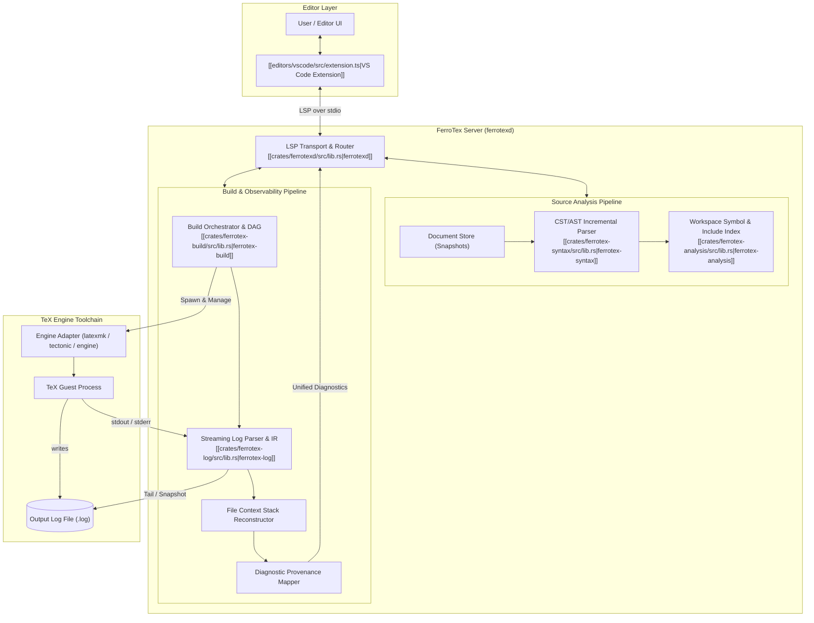

# `docs/architecture/overview.md`

## Purpose & Architecture Role

**FerroTex** is a modern LaTeX language platform and structured observability layer designed for the TeX ecosystem. Rather than attempting to replace legacy TeX engines (e.g., `pdflatex`, `xelatex`, `lualatex`, `tectonic`), FerroTex introduces a decoupled, non-intrusive dual-pipeline architecture:

1. **Source Analysis Pipeline**: Ingests LaTeX source code incrementally, builds a fault-tolerant Concrete and Abstract Syntax Tree (CST/AST), manages a global workspace index (labels, citations, macros, environments), and serves rich Language Server Protocol (LSP) language features.
2. **Build Observability Pipeline**: Monitors unstructured, volatile TeX compiler outputs via streaming stdout/stderr and `.log` file tailing, transforming chaotic engine messages into a typed, versioned Event Intermediate Representation (IR) with provenance and explicit uncertainty tracking.

### Design Philosophy & Architecture Contracts

- **Thin Extension, Thick Server**: All language intelligence, dependency graphs, project models, and build policies reside in the Rust server daemon (`ferrotexd`). Editor clients like the [[editors/vscode/src/extension.ts|VS Code Extension]] act as lightweight presentation and transport shells.
- **Engine Boundary as Adapter**: The compiler runner is strictly an adapter boundary. Parsing, timeline reconstruction, and diagnostic mapping are independent of any specific runner implementation (`latexmk`, `tectonic`, or direct engine invocations).
- **Zero-Trust & Sandbox Isolation**: TeX engines are treated as untrusted subprocesses with restricted filesystem views mediated via a virtual filesystem (VFS) and sanitized environment variables, preventing arbitrary command execution via `shell-escape` (see [[docs/architecture/security-model.md|Security Model]]).

### Core System Invariants

FerroTex enforces five foundational architectural invariants across all crates and pipelines:

- **I1: Provenance-Preserving Parsing**:
  - Every emitted build/log event MUST preserve a deterministic byte-span into the source log buffer.
  - Source diagnostics MUST preserve provenance linking to a precise document source range and, where applicable, a CST node identity.
- **I2: Typed, Versioned IR**:
  - All log events and diagnostic representations MUST belong to a versioned intermediate representation (`LogEventIR`). Any breaking schema changes require a formal schema version bump.
- **I3: Uncertainty as First-Class**:
  - Ambiguous engine states (e.g., parentheses in file paths or wrapped log lines) MUST be represented using explicit confidence metrics or unmapped states rather than heuristic guessing.
- **I4: Panic-Free Resilience on Hostile Input**:
  - Parsers MUST NOT panic on arbitrary byte sequences, broken encodings, or adversarial documents. Errors must be bounded, recovered, and emitted as diagnostic events.
- **I5: Incremental Friendliness**:
  - All subsystems support incremental operation: append-only log ingestion avoids re-parsing from byte 0, and incremental document edits re-parse only minimal affected syntactic nodes.

### Performance Boundaries & Target SLOs

As defined in [[docs/spec/performance-slos.md|Performance SLOs]], FerroTex is engineered around strict latency budgets:
- **Interactive Completion p95**: $\le 100\text{ ms}$
- **Interactive Hover p95**: $\le 100\text{ ms}$
- **Definition & References p95**: $\le 200\text{ ms}$
- **Semantic Tokens (Full) p95**: $\le 300\text{ ms}$ (with caching)
- **The "Incremental Everything" Speed Aspiration**: Complete document re-analysis within $\le 50\text{ ms}$ for documents up to 500 pages.
- **Mandatory Request Cancellation**: All long-running background tasks and LSP queries are preemptible.

---

## High-Level System Architecture

---

## Architectural Components & Key Symbols

### 1. LSP Server (`ferrotexd`)
- **Role**: Coordinates the system lifecycle, JSON-RPC stdio transport, virtual filesystem synchronization, build triggering, and diagnostic publishing.
- **Key Modules & Traits**:
  - Entry point and server loops in `ferrotexd`
  - Workspace management and client event dispatcher
  - Diagnostic unification engine (merging syntax diagnostics with engine log diagnostics)
- **Reference**: [[crates/ferrotexd/src/lib.rs|ferrotexd]]

### 2. Syntax Engine (`ferrotex-syntax`)
- **Role**: High-performance, fault-tolerant parser producing lossless Concrete Syntax Trees (CST) and semantic Abstract Syntax Trees (AST) with incremental editing capabilities.
- **Key Concepts**:
  - Token stream and recovery points
  - Concrete Syntax Tree (preserving trivia, whitespace, and byte offsets)
  - Semantic token extraction for syntax highlighting
- **Reference**: [[crates/ferrotex-syntax/src/lib.rs|ferrotex-syntax]]

### 3. Build & Orchestration Engine (`ferrotex-build`)
- **Role**: Manages compiler process lifecycles, execution sandboxing, toolchain adapters (`latexmk`, `tectonic`, direct TeX engines), and dependency DAG evaluation.
- **Key Concepts**:
  - `EngineAdapter` trait: abstracts command lines, flags, and process execution
  - Subprocess supervision, resource throttling, and clean environment scrubbing
  - VFS isolation and path translation
- **Reference**: [[crates/ferrotex-build/src/lib.rs|ferrotex-build]]

### 4. Log Event IR & Parser (`ferrotex-log`)
- **Role**: Streaming and offline parser for TeX output logs. Reconstructs execution timelines and parses unstructured TeX errors into structured events with exact byte ranges.
- **Key Structures**:
  - `LogBuffer`: Immutable byte slices supporting append-only growth snapshots
  - `EventStream`: Typed sequence of parsing tokens and log diagnostics
  - `FileContextStack`: Push/pop tree reconstructing TeX's ambiguous `(path` and `)` nesting
- **Reference**: [[crates/ferrotex-log/src/lib.rs|ferrotex-log]]

### 5. VS Code Client Extension (`editors/vscode`)
- **Role**: Thin editor client providing command registration, server binary discovery and bootstrapping, status bar item rendering, and log preview webviews.
- **Key Modules**:
  - Language client lifecycle (`LanguageClientOptions`, `ServerOptions`)
  - Workspace configuration synchronizer
- **Reference**: [[editors/vscode/src/extension.ts|VS Code Extension]]

---

## Core Data Structures & Models

| Data Structure | Pipeline | Purpose & Invariant |
| :--- | :--- | :--- |
| **`LogBuffer`** | Build | Immutable byte buffer capturing engine output; guarantees byte-offset provenance. |
| **`EventStream`** | Build | Typed sequence of log events (`FileEnter`, `FileExit`, `Error`, `Warning`, `BoxClip`). |
| **`FileContextStack`** | Build | State machine resolving ambiguous nested file inputs during compilation. |
| **`DocumentStore`** | Source | Thread-safe in-memory store of active document buffers synchronized via LSP text sync. |
| **`CST / AST`** | Source | Error-resilient parse tree carrying precise byte spans and node identities. |
| **`ProjectModel`** | Source/Build | Workspace hierarchy tracking root documents, child subfiles, and inclusion graphs. |
| **`SymbolIndex`** | Source | Fast query index for labels, bibtex citations, macros, and references. |

---

## Dependencies & Subsystems

The architecture connects several internal and external crates:
- [[crates/ferrotexd/src/lib.rs|ferrotexd]] - Central daemon orchestrating client communication and pipeline execution.
- [[crates/ferrotex-syntax/src/lib.rs|ferrotex-syntax]] - Incremental source parser and syntax tree builder.
- [[crates/ferrotex-build/src/lib.rs|ferrotex-build]] - Build runner abstraction and toolchain process management.
- [[crates/ferrotex-log/src/lib.rs|ferrotex-log]] - Typed log event IR and streaming parser.
- [[crates/ferrotex-core/src/lib.rs|ferrotex-core]] - Core primitives, diagnostic representations, and error structures.
- [[crates/ferrotex-analysis/src/lib.rs|ferrotex-analysis]] - Cross-file indexer, symbol resolver, and definition analyzer.
- [[editors/vscode/src/extension.ts|VS Code Extension]] - Primary editor client integration.

---

## Consumers & Dependents

- [[vault/FerroTex Overview.md|FerroTex Overview]] - Central knowledge graph index referencing this system overview.
- [[crates/ferrotexd/src/main.rs|ferrotexd binary]] - Executable entry point realizing the server architecture.
- [[crates/ferrotex-cli/src/lib.rs|ferrotex-cli]] - Command-line interface invoking build and parse pipelines directly.
- [[docs/architecture/data-flow.md|Data Flow Architecture]] - Detailed lifecycle walkthrough of events across these components.

---

## Related Specifications & ADRs

- [[docs/architecture/data-flow.md|Data Flow Architecture]] - Detailed phase-by-phase data flow and execution trace.
- [[docs/architecture/security-model.md|Security Model]] - Threat analysis, VFS jailing, and environment sanitization.
- [[docs/spec/lsp.md|LSP Spec]] - Normative Language Server Protocol feature matrix and capabilities.
- [[docs/spec/performance-slos.md|Performance SLOs]] - Latency targets, memory constraints, and cancellation invariants.
- [[docs/spec/provenance.md|Provenance Spec]] - Specification for diagnostic-to-source/log provenance mapping.
- [[docs/spec/vfs.md|VFS Spec]] - Virtual File System architecture for isolated build runs.
- [[docs/spec/log-event-ir.md|Log Event IR Spec]] - Specification of the typed log intermediate representation.
- [[docs/adrs/0001-typed-event-ir.md|ADR-0001: Typed Event IR]] - Architectural decision to model TeX log events as a typed stream.
- [[docs/adrs/0002-uncertainty-as-first-class.md|ADR-0002: Uncertainty as First-Class]] - Treating parser ambiguity with confidence values.
- [[docs/adrs/0003-thin-extension-thick-server.md|ADR-0003: Thin Extension, Thick Server]] - Strategy for keeping editor integrations minimal.
- [[docs/adrs/0004-streaming-incremental-parsing.md|ADR-0004: Streaming Incremental Parsing]] - Streaming parsing for logs and documents.
- [[docs/adrs/0005-universal-build-dag.md|ADR-0005: Universal Build DAG]] - Build execution graph semantics.
